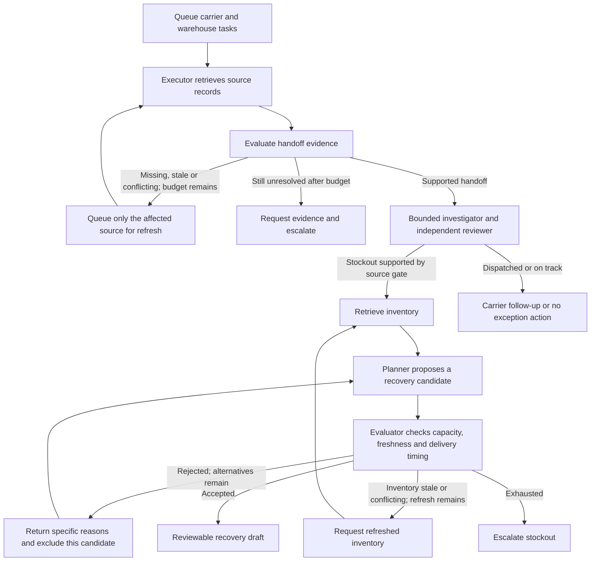

> Current product review: 43 tests pass, including snapshot-specific operator reviews and handoff packet export. Historical connected traces below remain unchanged.

# Adaptive investigation and recovery — October 23, 2026

The controller now turns validation failures into bounded work: refreshed retrieval, a different recovery proposal, or explicit escalation. It no longer collects every source unconditionally and then attaches a label-review loop.

## Try it

```sh
npm ci
npm run verify
npm run adaptive
```

`npm run adaptive` produces three synthetic cases in `runs/report.html`, using declared initial and refreshed records from `data/adaptive-cases.json`. It needs no credentials and makes no model calls. All state transitions are real application execution; the operational records are synthetic.

Connected mode, after setting the environment variables documented in `.env.example`:

```sh
npm run demo -- --zetaris --live-model
```

Nightshift model review is enabled by default in live mode; `--no-review` explicitly disables it. All model requests use Nightshift. The model selects among queued evidence tasks and, when multiple recovery candidates exist, chooses a candidate for independent checking. Invalid responses use a traced deterministic fallback.

## State and feedback



Source-gate issues carry a source, code and reason. Recovery rejections carry concrete reasons such as `insufficient_capacity`, `promise_infeasible` or `inventory_stale`. They drive the next task; they are not decorative explanations appended afterward. Model cause feedback no longer supplies the expected category.

Bounds: two retrieval attempts per source, at most six initial recovery proposals, two cause-review rounds, and at most six batch-capacity candidates per order. A regressed or malformed refresh cannot replace valid current evidence. Refreshed observations must fit the same explicit `asOf` snapshot. Future observations are rejected. Real actions are never executed.

The sample planner ranks transfers by speed before the evaluator checks all constraints. The live model can choose a feasible candidate first. A rejected first proposal is not forced merely to make a demo look agentic. Batch allocation reuses evaluated proposals where possible; if higher-priority drafts consume stock, the evaluator rejects the changed capacity and tries another warehouse.

## Connected source contract

`openZetaris()` reads orders first. Each queued evidence task performs a real fixed-template JDBC SELECT for the corresponding table; confirmed dispatch does not retrieve inventory. Refresh normally rereads the same table. Operators may configure a same-schema `ZETARIS_REFRESH_<SOURCE>_TABLE` identifier for an explicit update view. Models never generate SQL or table mappings. The 1000-row limit fails closed, so this remains a bounded prototype adapter.

The separate `shipment_rescue_adaptive` test schema contains baseline warehouse observations and an explicit `warehouse_updates` source. It preserves the original `shipment_rescue` tables. Registration SQL and all five synthetic CSVs are included. Read the integration README before setting it up.

## Measured evidence

- **39 tests pass**, including transient outage recovery, bounded permanent outage, selective retrieval, stale/conflicting evidence repair, regressed snapshot rejection, stale inventory refresh, alternative plans and batch capacity replanning. A controlled model-response test verifies that a rejected planner choice feeds structured reasons into a later model choice. That test is not live-model performance evidence.
- **12/12 original deterministic regression cases pass.**
- Six reused synthetic live regression cases: **6/6 final evidence-gated outcomes**, six accepted task choices, no tool fallback, **4/6 reviewer agreements and 2/6 review fallbacks**, 33.8 seconds total. These were previously used during development and are not new independent holdouts.
- Real Zetaris queries with the deterministic controller: **3/3 adaptive cases**, 32.488 seconds total. AD-201 required a warehouse refresh, rejected West (two units for an order of four), then accepted East. AD-202 skipped inventory. AD-203 exhausted its handoff refresh budget and requested evidence.
- Zetaris + Nightshift/Nemotron: **3/3 adaptive cases**, 44.253 seconds total. Four valid task choices plus one valid model recovery choice; no tool/planner fallback. AD-201 refreshed warehouse evidence and Nemotron selected feasible East immediately. Two model reviews agreed and the unresolved case used review fallback. This live run did not require a recovery-plan rejection; do not splice the deterministic rejection into a purported model trace.

An earlier single-case connected baseline attempt returned a correct guarded result with reviewer agreement but needed one task-selection fallback (`adaptive-baseline-connected.json`); a zero-fallback run is not proof of universal model reliability.

Raw evidence: `evidence/adaptive-zetaris-policy.json`, `evidence/adaptive-zetaris-nightshift.json`, `evidence/evaluation-live-adaptive-v5-regression.json`. These are small synthetic developer evaluations, not field impact, model accuracy estimates, p95 latency or production reliability.

## Remaining limitations

The source/task universe is bounded, role-specific and controlled by code, not open-ended autonomous delegation. Source validation, feasibility and capacity accounting are intentionally deterministic. Cause reviewers still make mistakes, memory uses the reference hash embeddings, the capacity ledger does not coordinate independent runs, and no customer validation exists. The adaptive behavior is implemented and exercised; this does not certify prize competitiveness or production readiness.

Nothing was submitted, published or uploaded. The deck, narrated trace replay and submission narrative under `../shipment-rescue-submission` have been refreshed for this architecture. They remain local review artifacts, not an uploaded or submitted entry.
